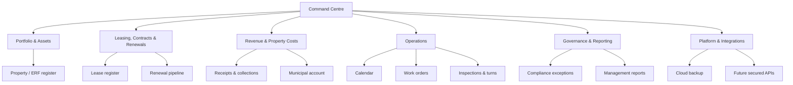
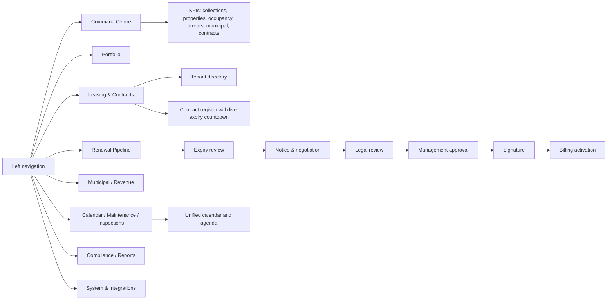
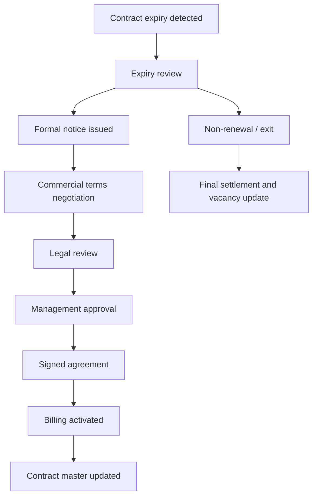
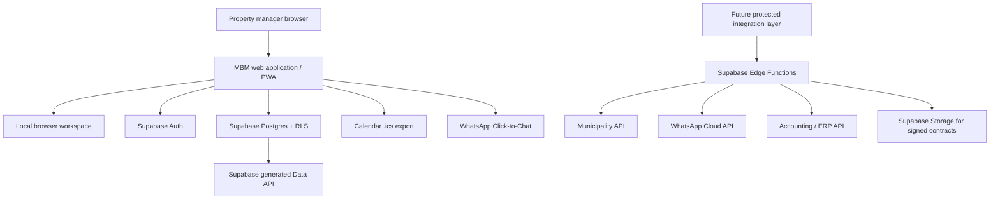

# MBM Corporate Property Management System

## Product purpose

MBM is a corporate property-operations system for a property manager. It is designed to control the full landlord revenue lifecycle: property records, leases, renewal decisions, rent collection, municipal exposure, maintenance, inspections, compliance and reporting.

The first release remains deliberately low-cost: a static GitHub Pages web application, Supabase authentication and private cloud backup, and free WhatsApp Click-to-Chat. It does not pretend to be a complete ERP or a municipality payment gateway.

## Corporate information architecture

## Live application wireframe

## Renewal-control wireframe

The system does not allow a renewal to activate until legal approval, management approval, signed agreement reference, signature date, billing activation date, term and rent are recorded.

## Working modules in this version

| Corporate area | What is operational now | Main control |
|---|---|---|
| Portfolio | Property / ERF master and occupancy links | One approved property record used by leases and operations |
| Leasing & contracts | Tenant/unit/rent, contract reference, status, start/end and private document upload | Expiry countdown, contract register and secure document opening |
| Renewals | Case pipeline, notice date, proposed terms, legal/approval states, signature and billing activation | Activation gate updates the live lease only after approvals |
| Revenue | Rent receipts, collections history, arrears reporting, CSV import/export | Receipts remain linked to tenant and unit |
| Municipal | One current municipal bill per property | Overdue municipal balance appears in compliance and calendar |
| Operations | Work orders, assignment, priority, due date, inspections and unit turns | Open deadlines appear in calendar |
| Calendar | Unified automatic agenda plus manual property events; `.ics` export | One operational view of due dates |
| Governance | Exceptions for missing contracts, expiry/renewal follow-up and municipal exposure | Management action queue |
| Cloud | Supabase sign-in, private backup/restore and owner Row Level Security | One private owner record in the starter edition |

## Technology architecture: starter edition

### What is used now

- Static responsive web application hosted on GitHub Pages.
- Progressive-web-app caching for local app assets and basic offline use.
- Supabase Auth and Row Level Security for the owner account.
- Supabase Postgres private cloud backup for application data.
- Free WhatsApp Click-to-Chat: messages are prepared, then a staff member reviews and sends them.
- Calendar `.ics` export, which can be imported into Outlook or Google Calendar without an integration subscription.

### Technology still reserved for later phases

| Capability | Why it is needed | Safe implementation boundary |
|---|---|---|
| Expanded document vault | Store lease supporting records, IDs, approvals and inspection evidence | Extend the current private contract bucket with document metadata and staff policies |
| Municipality integration | Read authorised municipal balances and statements | Supabase Edge Function; municipality credential stored only as a Supabase secret, never in this website |
| WhatsApp Cloud API | Template messaging and delivery logging | Edge Function webhook and a verified Meta business account; this is not guaranteed free |
| Accounting / ERP export | Post approved rent, deposits and municipal costs | One server-side connector with a mapped chart of accounts |
| Staff roles | Let agents, finance, managers and directors see only their work | Normalised users, organisations and role-based RLS policies |
| Multi-property API | Share approved data with a reporting or owner portal | Read-only views and authenticated REST / Edge Function endpoints |

## Data architecture and migration path

### Current low-cost starter model

`public.mbm_app_state` holds one private cloud record per owner. It stores the property master, tenant/lease master, receipts, municipal accounts, operations data, renewal cases and manual calendar events as JSON. This keeps setup simple for a first-time developer and remains protected by owner-based Row Level Security.

### Corporate scale-up model

Before adding multiple staff or external API access, migrate to normalised tables:

| Domain | Tables to add |
|---|---|
| Organisation & people | `organisations`, `staff_profiles`, `roles`, `role_permissions` |
| Portfolio | `properties`, `buildings`, `units`, `owners` |
| Leasing | `tenants`, `lease_contracts`, `lease_terms`, `renewal_cases`, `approval_actions` |
| Financial | `charges`, `invoices`, `payments`, `municipal_accounts`, `municipal_statements` |
| Operations | `work_orders`, `vendors`, `inspections`, `calendar_events` |
| Documents | `documents`, `document_links`, private Storage bucket objects |
| Integration & audit | `integration_connections`, `sync_runs`, `audit_events` |

Every table must contain organisation ownership, timestamps and RLS rules. External calls must go through Edge Functions, never through browser JavaScript containing a secret key.

## Build order

1. **Stabilise the current system:** load the provided SQL migration, test cloud save/restore, and enter real property/lease records.
2. **Adopt the renewal control:** begin renewal cases 90+ days before expiry; require legal and approval states before activation.
3. **Use the calendar as the daily operations desk:** manage renewals, inspections and work orders from its agenda; import its `.ics` file into Outlook/Google Calendar if required.
4. **Expand secure contract documents:** attach supporting evidence and document metadata to the current private contract vault.
5. **Normalise the database:** do this before inviting staff or exposing any external API.
6. **Add server-side integrations:** municipality, accounting and WhatsApp Cloud API only after documented permission, credentials, rate limits and test data are available.

## Non-negotiable security rules

- Never place a Supabase service-role/secret key, municipality password or Meta token in GitHub Pages or browser code.
- Use only the publishable key in the web app.
- Keep Row Level Security enabled on every new table and Storage object policy.
- Do not promise automatic municipal balance access until the municipality provides an authorised API and credentials.
- Treat agreement documents, tenant IDs and financial information as private records; use private Storage plus signed access, not public file URLs.
