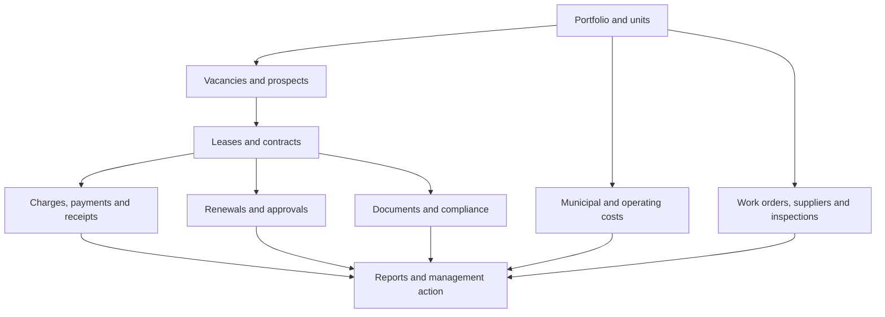
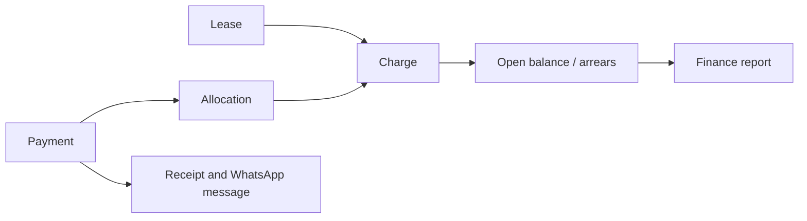

# MBM Property Manager V10 — operating architecture

MBM is designed as a single property-management workspace rather than a collection of receipt pages. It supports residential, commercial, mixed-use and land portfolios.

## Daily operating flow

## Product areas

| Area | Purpose | Key controls |
|---|---|---|
| Dashboard | Daily management desk | Occupancy, rent, bills, exceptions, renewals and open work |
| Portfolio & Units | The master asset record | Each lease, bill, work order and report uses the same property and unit |
| People & Vacancies | Owners, leads and availability | Vacancy board, asking rent, follow-up dates and lease conversion path |
| Leases & Contracts | Controlled commercial agreement | Deposit, escalation, expiry countdown, agreement reference and evidence |
| Renewals | A governed lifecycle, not a reminder | Notice, negotiation, legal approval, management approval, signature and billing gate |
| Receivables | Rent and other money due/received | Charge types, allocations, printable receipts, arrears view and payment history import |
| Municipal Accounts | Current property account exposure | One current statement balance per property, due date, payment history and future API mapping |
| Operations | Maintain the physical asset | Supplier directory, quoted vs actual cost, work orders, inspections, defects and unit turns |
| Documents & Compliance | Evidence and early warning | Private document paths, contract/compliance exceptions and audit history |
| Reports & Insights | Management decisions | Executive, finance, vacancy, lease, municipal, operations, documents and compliance reports |
| Administration | Controls and recovery | Private backup, V1–V9 migration, roles and audit trail |

## Financial model

This avoids treating a receipt as the only finance record. A charge is the amount due; a payment is money received; an allocation proves which charge was reduced.

## Cloud and integration boundary

The current zero-cost edition uses GitHub Pages, Supabase Auth/private backup and WhatsApp Click-to-Chat. The normalised Supabase schema is prepared for staff access and future integrations.

| Integration | Approach | Safety boundary |
|---|---|---|
| Municipality statement/balance | Authorised API via Supabase Edge Function | API credential is a server-side secret; never browser code |
| WhatsApp automation | Future Cloud API/Edge Function | Current free version only prepares messages for staff review |
| Owner or tenant portal | RLS-protected Supabase views/API | Owners and tenants see only records assigned to them |
| Accounting export | Read-only report view or scheduled CSV | Start with exports; add posting only after reconciliation rules exist |
| Staff permissions | `organization_members` with RLS | Administrator, Property Manager, Finance, Operations, Legal and Viewer |

## Delivery stages

1. **Use now:** browser workspace, V1–V9 migration, backups, records, receipts, WhatsApp, reports and calendar.
2. **Secure cloud:** run the supplied SQL, test sign-in and private backup, upload agreements to the private vault.
3. **Multi-user:** connect screens to the organisation-scoped tables and enforce roles.
4. **Controlled integrations:** add municipality/API, owner portal and accounting export through Edge Functions only.
